# Xavier

> 🚧 Inspired by Grok Bot. For fun, not for production use.

Xavier gives AI access to a browser, code execution, and website monitoring.
Hand off tasks and watch the results.

Xavier is a self-hosted harness, not an AI agent. Connect a model, describe the
work, and let it investigate websites, process data, produce files, or work in a
browser. You can follow progress, take control of the Computer, and approve
consequential actions.

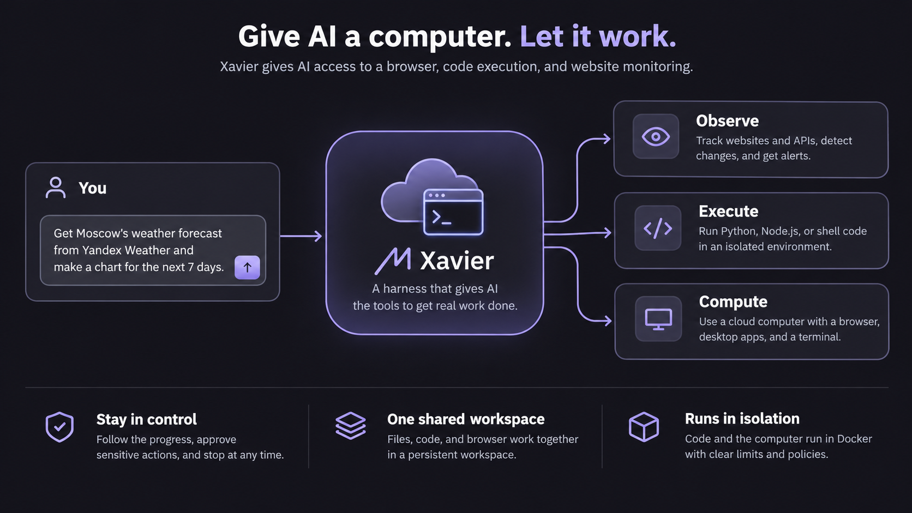

## Showcase

One task, from an empty chat to a chart.

<details name="showcase-01" open>
<summary>1 / 14 · New chat</summary>

<p align="center">
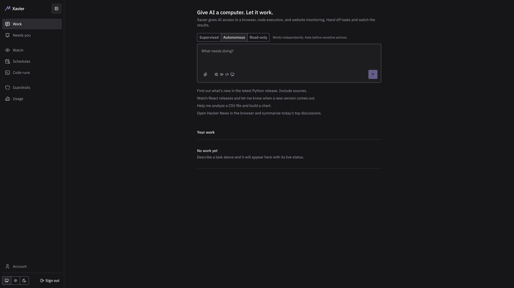
</p>

</details>

<details name="showcase-01">
<summary>2 / 14 · Describe the task</summary>

<p align="center">
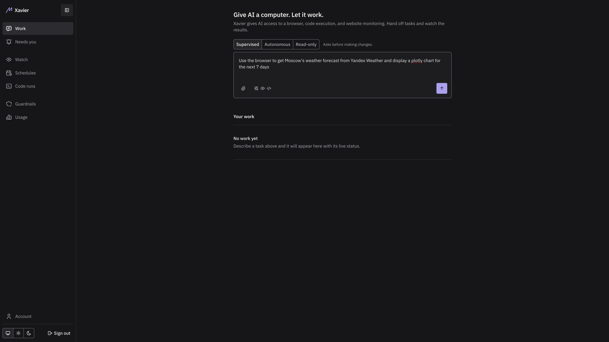
</p>

</details>

<details name="showcase-01">
<summary>3 / 14 · Choose tools</summary>

<p align="center">
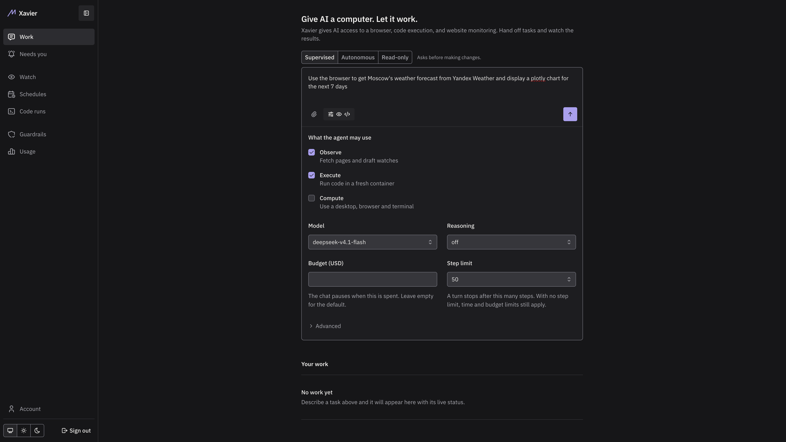
</p>

</details>

<details name="showcase-01">
<summary>4 / 14 · Add the Computer</summary>

<p align="center">
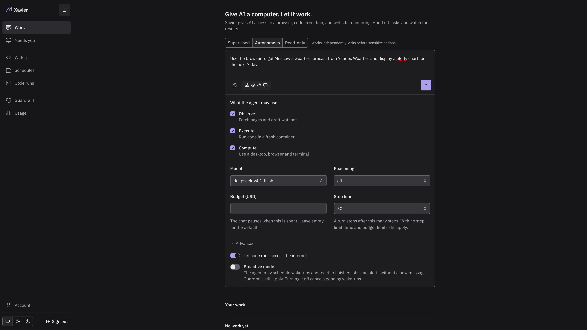
</p>

</details>

<details name="showcase-01">
<summary>5 / 14 · Proactive mode</summary>

<p align="center">
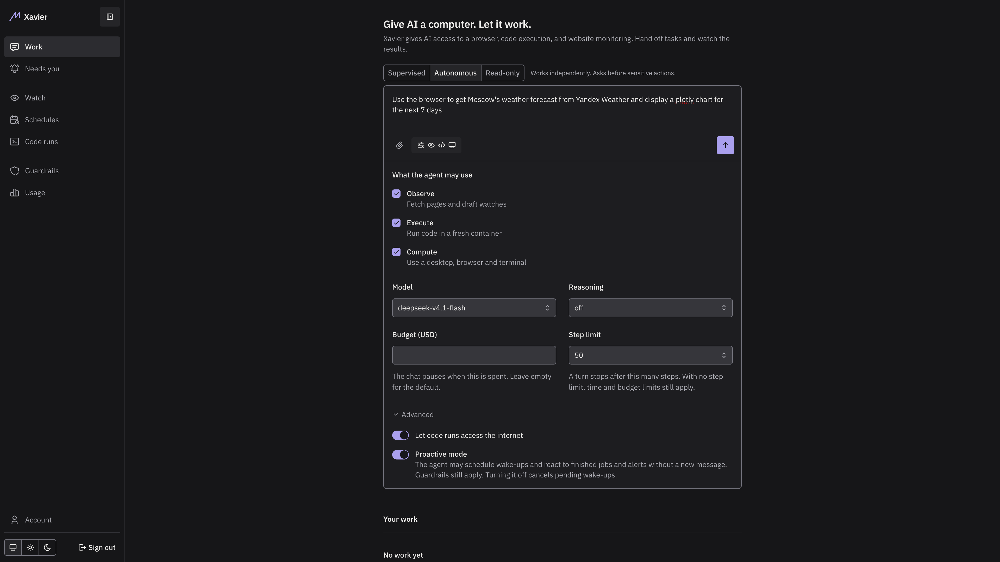
</p>

</details>

<details name="showcase-01">
<summary>6 / 14 · Send it</summary>

<p align="center">
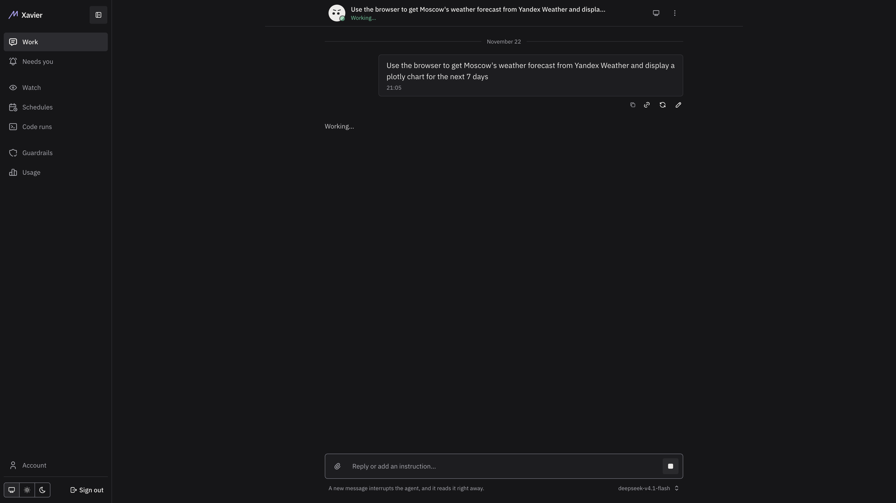
</p>

</details>

<details name="showcase-01">
<summary>7 / 14 · Follow the run</summary>

<p align="center">
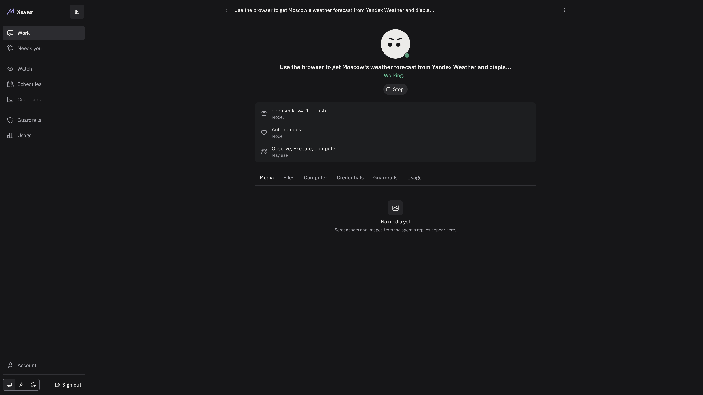
</p>

</details>

<details name="showcase-01">
<summary>8 / 14 · Watch the Computer</summary>

<p align="center">
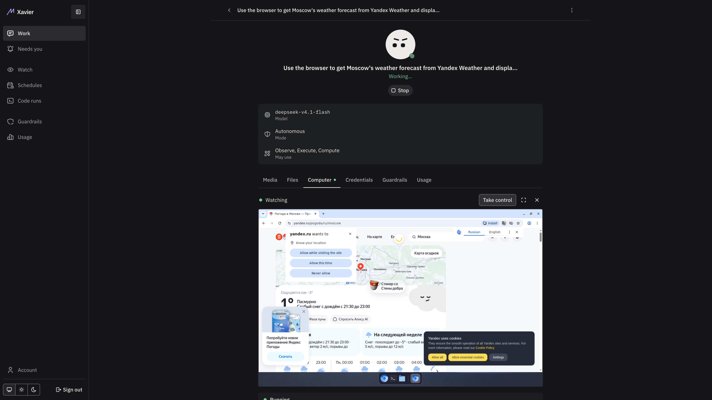
</p>

</details>

<details name="showcase-01">
<summary>9 / 14 · Credentials</summary>

<p align="center">
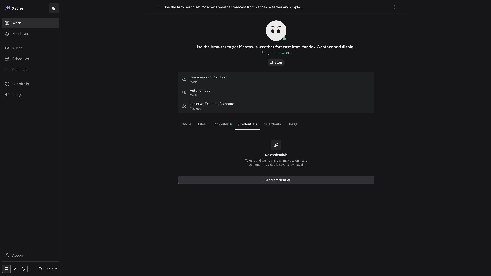
</p>

</details>

<details name="showcase-01">
<summary>10 / 14 · Add a credential</summary>

<p align="center">
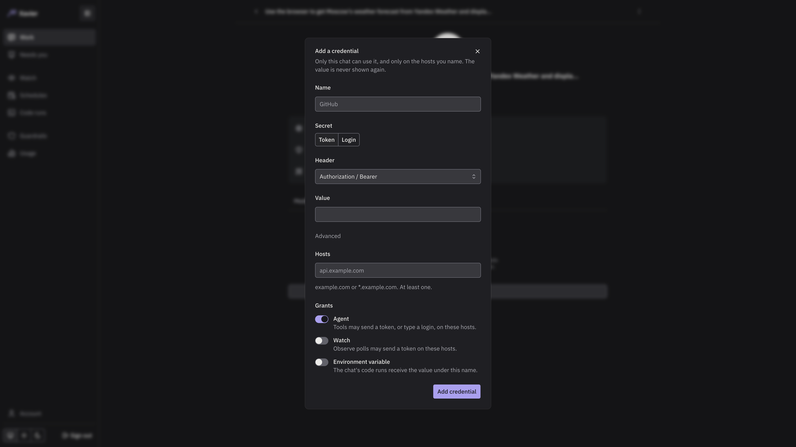
</p>

</details>

<details name="showcase-01">
<summary>11 / 14 · Files</summary>

<p align="center">
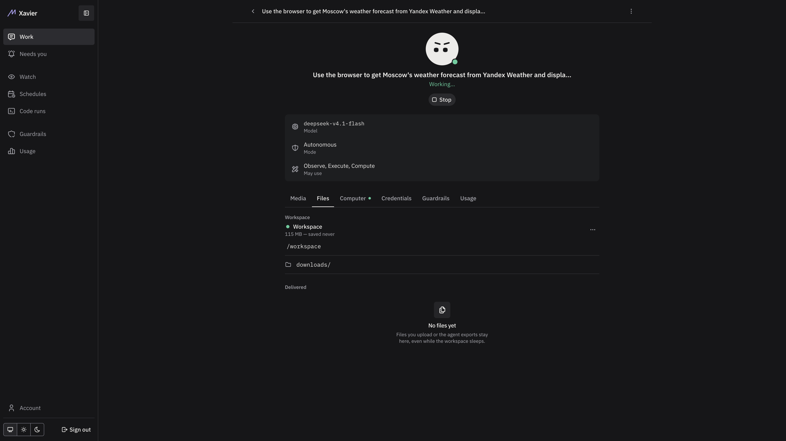
</p>

</details>

<details name="showcase-01">
<summary>12 / 14 · While it works</summary>

<p align="center">
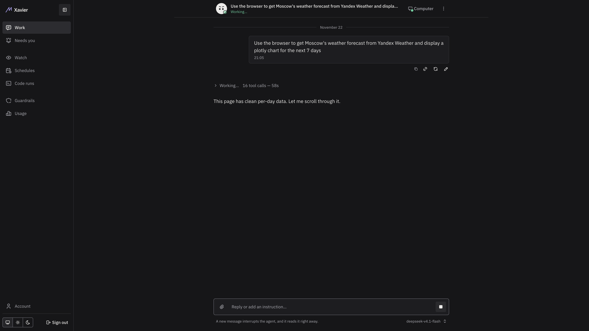
</p>

</details>

<details name="showcase-01">
<summary>13 / 14 · The result</summary>

<p align="center">
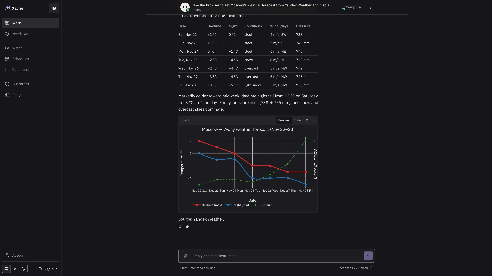
</p>

</details>

<details name="showcase-01">
<summary>14 / 14 · The chart</summary>

<p align="center">
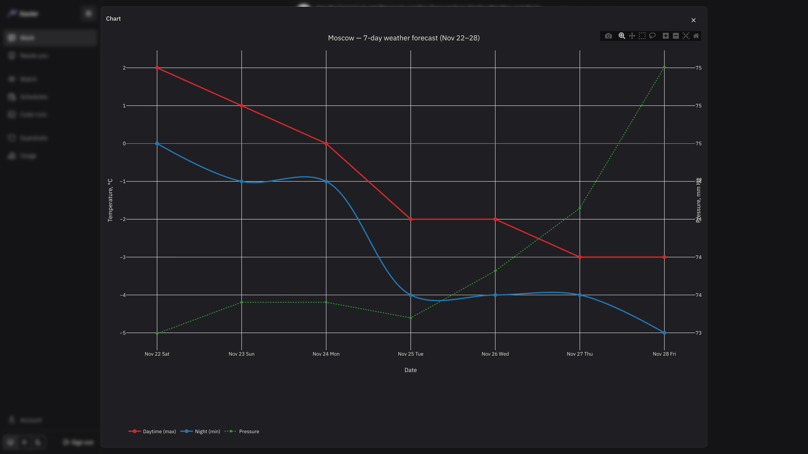
</p>

</details>

## What AI can do with Xavier

### Observe

Keep track of websites and APIs without repeatedly running a model.

Xavier records versions, detects meaningful changes, preserves history, and
raises alerts when content changes, resources disappear, credentials expire, or
the structure of the data changes. AI can explore a source and draft the
monitoring rules; polling then runs deterministically on a schedule.

Track product releases, prices, availability, documentation, APIs, listings,
competitors, regulations, jobs, publications, or any other changing web source.

### Execute

Run Python, Node.js, or shell commands in isolated containers.

Every run starts in a clean environment with explicit limits on time, memory,
network access, and output. Code can read and write the chat's persistent
workspace, process downloaded data, generate reports, and export results as
downloadable artifacts.

Analyze and transform data, call APIs, automate repeatable operations, validate
information collected from the web, and generate CSV, JSON, charts, reports, or
other files.

### Compute

Give AI a complete Linux computer with Chromium, a desktop, and a terminal.

It can navigate websites, interact with web applications, download files, use
desktop software, and combine browser work with code. You can watch the screen
in real time and take control of the mouse and keyboard whenever needed.

Use the Computer for work that cannot be completed through an API or a simple
HTTP request.

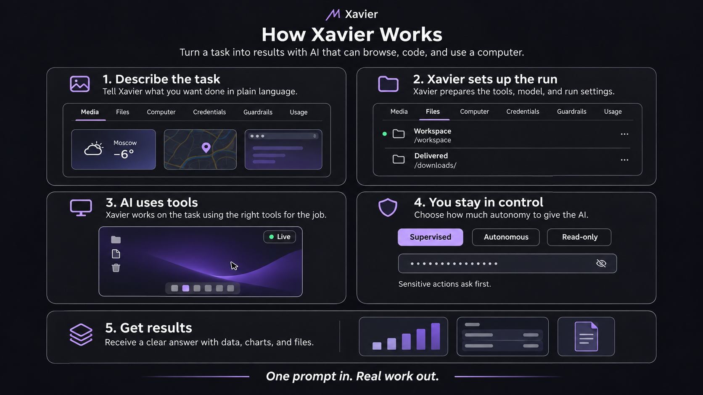

## One shared workspace

Observe, Execute, and Compute are not separate products.

A file downloaded in Chromium can be processed by Python. A report generated by
code can be opened in the browser. Data discovered during research can become a
monitored source. Files remain available across turns, and idle workspaces can
hibernate and resume on another worker.

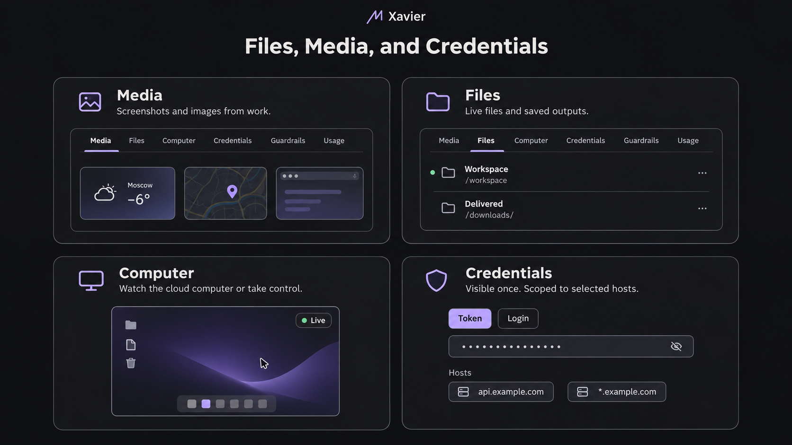

This makes it possible to complete an entire workflow in one chat:

1. investigate a source in the browser;
2. collect and analyze its data with code;
3. deliver the result as a file;
4. continue monitoring the source for future changes.

See [Workspace, Execute and Compute](docs/workspace.md) for details.

## Staying in control

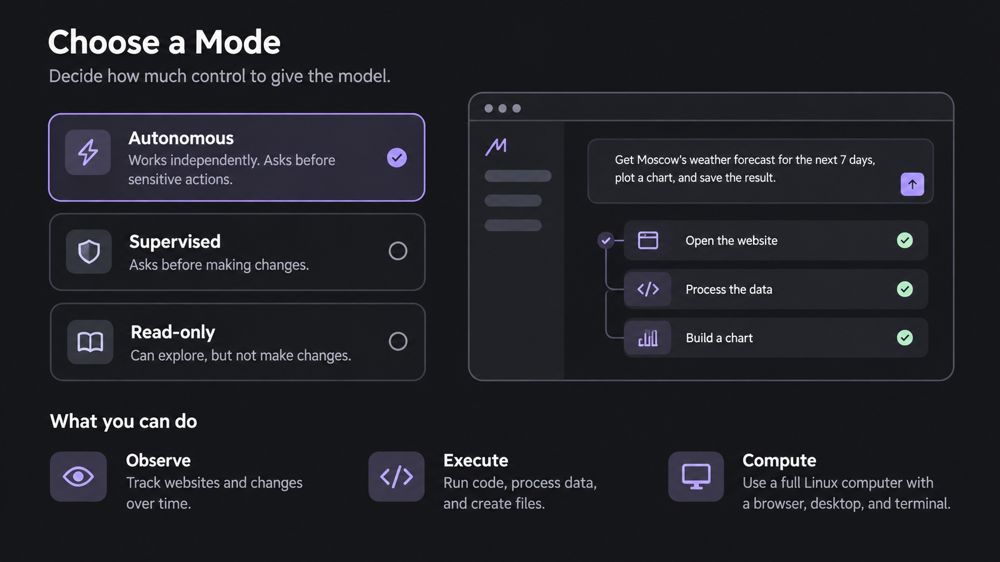

- Tool calls are allowed, denied, or held for approval by policy.
- Code runs and Computers are isolated in Docker.
- Chats have budgets and execution limits.
- Tasks can be paused or stopped immediately.
- Actions, decisions, results, and changes remain in the chat history.
- Untrusted pages and files cannot override policy rules.

See the [security model](docs/security.md) for the isolation and trust
boundaries.

## Quick start

Requirements:

- macOS with Docker Desktop, or Linux with Docker Engine; Docker Compose 5.7.0
  or later.
- [uv](https://docs.astral.sh/uv/), to generate a key and to run the CLI on the
  host.
- An API key of an OpenAI-compatible model provider, such as OpenRouter.

```bash
git clone https://github.com/machnevegor/xavier.git && cd xavier

# Settings: fill in worker.internal_token, the provider api_key and
# observe.credentials_key (see docs/operations.md#configuration).
cp apps/server/settings.example.yaml apps/server/settings.yaml

# Images of the code sandbox and of the Computer.
docker build -t xavier-sandbox:local apps/server/images/sandbox
docker build -t xavier-desktop:local apps/server/images/desktop

# On Linux only: let the worker use the Docker socket.
export DOCKER_GID=$(stat -c %g /var/run/docker.sock)

# The infrastructure, then the apps.
docker compose -f infra/docker-compose.yml up -d
docker compose up -d --build
```

Create the first user, then open <http://localhost:8080> and sign in with it.
The REST API is at <http://localhost:8080/api/v1>, with interactive
documentation at <http://localhost:8080/api/v1/docs>; the Temporal UI is at
<http://localhost:8233>. All ports listen on 127.0.0.1 only.

```bash
docker compose exec server xavier users create <username>
```

Start a chat in **Work**, or through the API with a key from the Account page:

```bash
export XAVIER_API_KEY=<the key, shown once when created>
curl -sS -X POST http://localhost:8080/api/v1/chats \
  -H "Authorization: Bearer $XAVIER_API_KEY" -H 'Content-Type: application/json' -d '{
  "data": {
    "tool_groups": ["execute", "compute"],
    "text": "Open https://quotes.toscrape.com, save the quotes of the first page to a CSV file and export it."
  }
}'
```

## Documentation

| Document                             | Contents                                                                   |
| ------------------------------------ | -------------------------------------------------------------------------- |
| [Architecture](docs/architecture.md) | components, data, workflows, API conventions, code layout                  |
| [Chats and the agent](docs/agent.md) | chat states, turns, approvals, schedules, recovery                         |
| [Workspace](docs/workspace.md)       | the shared workspace, Execute runs and the Computer                        |
| [Observe](docs/observe.md)           | sources, polling, versions, alerts and credentials                         |
| [Tools](docs/tools.md)               | the agent's tools and their arguments                                      |
| [Security model](docs/security.md)   | trust, policy, isolation, egress and secrets                               |
| [Web UI](docs/web-ui.md)             | the client's architecture and design conventions                           |
| [Operations](docs/operations.md)     | configuration, upgrades, health, several workers, backups, troubleshooting |
| [Development](docs/development.md)   | repository layout, environments, everyday commands                         |
| [Testing](docs/testing.md)           | unit, integration and end-to-end tests, static checks                      |
| [Performance](docs/performance.md)   | measured latencies and how to measure them                                 |
