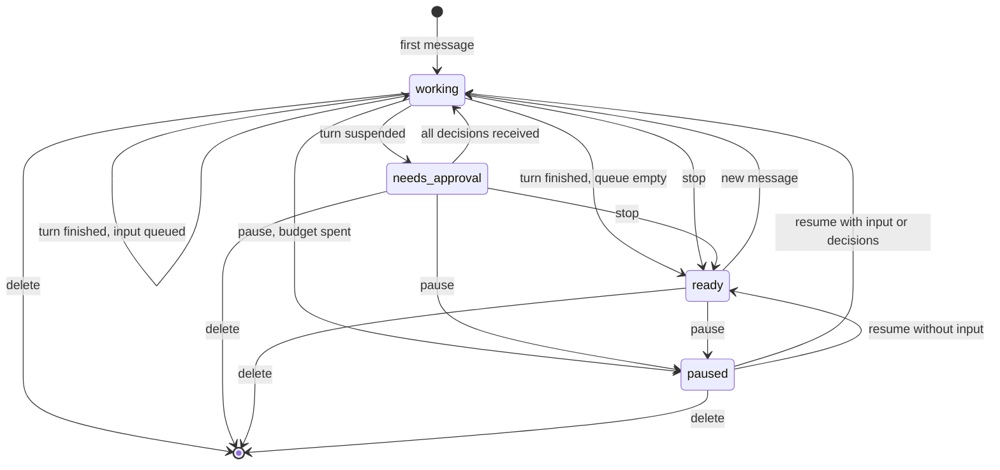
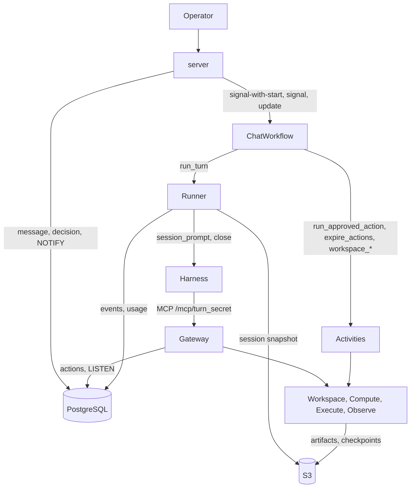
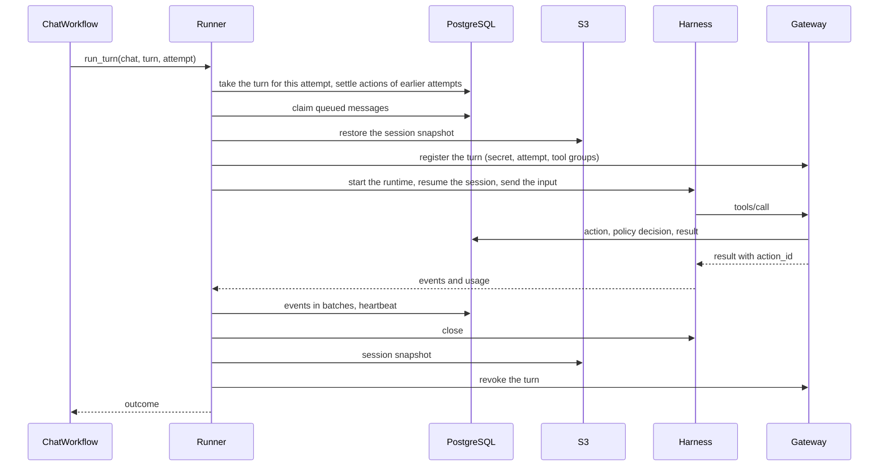
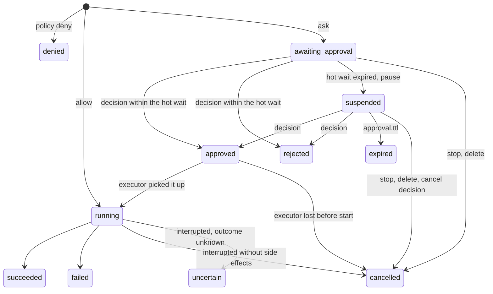
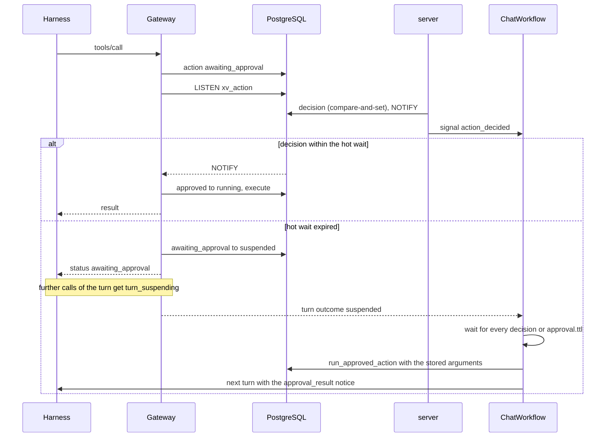

# Chats and the agent

How a chat runs: its states, the turn that runs the model, tool calls and
approvals, and recovery from failures. The components are introduced in
[architecture](architecture.md); the tools themselves are in [tools](tools.md).

## Chat

| Entity  | What it is                                                                                                                |
| ------- | ------------------------------------------------------------------------------------------------------------------------- |
| Chat    | a conversation with settings: model, reasoning level, moderation mode, tool groups, `execute_network`, budget, step limit |
| Message | operator input: text, images and attached files (artifacts)                                                               |
| Turn    | one pass of the agent over the queued input until it answers; its result is `turns.final_response`                        |
| Action  | one tool call: arguments, risk, policy decision, status and result                                                        |
| Event   | an entry of the chat feed, streamed to the Web UI over SSE                                                                |

Settings omitted when the chat is created come from `chat.*`,
`agent.default_model` and `turn.max_steps`. A chat's `max_steps` limits the
steps of its turns; `null` sets no step limit. `PATCH /chats/{id}` changes
settings from the next turn.

### States



| State            | Meaning                                                              |
| ---------------- | -------------------------------------------------------------------- |
| `working`        | a turn, or the execution of approved actions, is in progress         |
| `needs_approval` | the agent waits for operator decisions                               |
| `ready`          | the agent waits for a message; the last turn's answer is in the feed |
| `paused`         | no turns start; messages queue up and pending decisions are kept     |

Operator commands:

- **Stop** ends the current turn. Unfinished actions and pending decisions are
  cancelled; the chat goes to `ready`.
- **Pause** ends the turn like stop but keeps pending decisions, and starts no
  turn until **resume**. Decisions are still accepted, and the approval timer
  keeps running.
- **Resume** lifts the pause. Queued input or decisions start a turn with the
  `resumed` notice. A chat paused because its budget is spent cannot resume
  (`409`) until `budget_usd` is raised.
- **Delete** (`DELETE /chats/{id}`, workflow update `delete`) stops the turn,
  cancels wakeups, pending decisions and executions, and hibernates the
  workspace. The chat gets `deleted_at` and `deleted_by`, disappears from lists
  and reads at once, and is purged after `retention.deleted`. Delete is not a
  chat status.

Messages that arrive during a turn wait for the next turn. Turn limits and model
errors are turn outcomes, not chat states: the chat returns to `ready` and the
operator can keep writing.

### Schedules

A schedule (`/api/v1/schedules`, the **Schedules** section of the Web UI) is a
Temporal Schedule that posts a message into a new chat built from a template, or
into a pinned chat (`chat_id`). `timing` holds exactly one of `at` (once, then
no further runs), `interval` or `cron` with a `time_zone`. Each run starts
`ChatScheduleWorkflow`, which creates the chat if needed, stores the message and
signals the chat workflow.

```bash
curl -sS -X POST http://localhost:8080/api/v1/schedules \
  -H "Authorization: Bearer $XAVIER_API_KEY" -H 'Content-Type: application/json' -d '{
  "data": {
    "name": "Morning digest",
    "timing": {"cron": "0 9 * * 1-5", "time_zone": "Europe/Moscow"},
    "text": "Summarize the new Observe alerts since yesterday.",
    "tool_groups": ["observe"]
  }
}'
```

## Responsibilities

| Component                        | Responsible for                                                                                                                        |
| -------------------------------- | -------------------------------------------------------------------------------------------------------------------------------------- |
| Harness runtime                  | the model loop, LLM request retries, context compaction, the session log                                                               |
| MCP gateway (`agent/gateway.py`) | tool contracts, validation, policy, the action log, the short approval wait, execution, result shape, cancelling the turn's actions    |
| Runner (`agent/runner.py`)       | the runtime's home directory, runtime start and close, input, the event stream, turn budgets, heartbeats, the session snapshot         |
| `ChatWorkflow`                   | chat status, one turn at a time, the input queue, durable waits and timers, approved suspended actions, pause, stop, delete, workspace |
| PostgreSQL                       | decisions and actions; messages, turns, events, workspaces, the status projection                                                      |
| `server`                         | operator commands: writes to PostgreSQL, then signals or updates the workflow                                                          |



`ChatWorkflow` messages:

- **Signals:** `input_available`, `action_decided`, `wake_workspace`,
  `hibernate_workspace`, `delete_workspace`.
- **Updates**, which return the resulting state: `pause`, `resume`, `stop`,
  `delete`.
- **Query:** `state`.

New messages are stored first and then delivered with signal-with-start, so the
same call works whether the workflow is running or has completed. A message
stored while Temporal is down stays `queued`; the next message or command
delivers it, and `MaintenanceWorkflow` re-signals chats whose input has been
queued for over two minutes.

## Turn

A turn is the activity `run_turn`. It runs on the host queue of the chat's
active workspace, or on the shared queue when the workspace is not active; the
gateway then activates the workspace on the turn's worker when a tool needs it.
Tool calls go straight to the services, without a Temporal round trip per call.



1. **Fencing.** The turn row stores the attempt that owns it. A retry takes the
   turn only with a higher attempt number; otherwise it fails with the
   non-retryable `stale_attempt`. Actions of earlier attempts are settled with
   code `interrupted`: a running read becomes `failed`, a running write
   `uncertain`, waiting and approved actions `cancelled`.
2. **Input.** Queued messages are claimed for the turn, so a retry takes the
   same ones. Images go to models with image input; attached files are copied
   into `/workspace/inbox/` and announced as `[attachment]` blocks.
3. **Runtime.** Every attempt gets a fresh runtime home directory into which the
   snapshot is restored. The working directory is `agent.cwd`, identical on
   every worker, because Harness derives the session location from it.
4. **Events** go to PostgreSQL in batches every 250 ms or 50 events; the
   activity heartbeats every 5 s. Every gateway result carries its `action_id`,
   which links Harness tool calls to actions.
5. **Budgets.** Steps are limited by the chat's `max_steps` (`null` sets no step
   limit), time by `turn.timeout` and cost by the chat budget, priced from the
   model's `pricing_per_mtok`. Exceeding one stops the turn as `limited`.
6. **Finalization** always runs: the gateway cancels the turn's remaining
   actions, the runtime is closed, the snapshot uploaded, the turn's MCP secret
   revoked and the home directory removed.

Turn outcomes (`turns.status`):

| Outcome     | Cause                                                | The chat then                                                  |
| ----------- | ---------------------------------------------------- | -------------------------------------------------------------- |
| `completed` | a final answer                                       | `ready`, or the next turn if input is queued                   |
| `suspended` | actions wait for a decision                          | `needs_approval`                                               |
| `stopped`   | stop, pause or delete                                | `ready` or `paused`; a deleted chat is hidden                  |
| `limited`   | the chat's `max_steps`, `turn.timeout` or the budget | `ready` with a `limit_reached` notice; `paused` for the budget |
| `failed`    | a model error, or every activity attempt failed      | a model error is retried once after 30 s; otherwise `ready`    |

### Harness integration

The agent runtime is the DeepSeek Harness SDK (`deepseek-harness-sdk`, pinned to
`0.2.2rc2`) with its OpenAI-compatible LLM plugin and its MCP client. Its
behaviour shaped these decisions:

| Harness property                                                                                         | Consequence in Xavier                                                   |
| -------------------------------------------------------------------------------------------------------- | ----------------------------------------------------------------------- |
| The runtime starts in under a second                                                                     | a runtime is started per turn and closed after it                       |
| A session continues on another host when its files are copied; the path depends on the working directory | sessions are snapshotted to S3; `agent.cwd` is the same on every worker |
| Resuming a session after `close()` mid-turn repairs the interrupted turn                                 | a turn is interrupted by closing the runtime                            |
| Closing the runtime does not cancel running MCP tool calls                                               | the gateway cancels the turn's actions itself                           |
| The SDK has no turn cancellation; request timeouts only bound RPCs                                       | the runner enforces turn budgets                                        |
| The minimal profile has no approval of MCP calls                                                         | approvals are implemented entirely in Xavier                            |
| MCP image content reaches the model                                                                      | screenshots are returned as tool results                                |
| The runtime inherits the worker environment                                                              | the worker environment holds no secrets                                 |

The runtime uses the `sdk-minimal` profile with a patch
(`apps/server/src/agent/profile.py`) that disables its shells, file tools and
own session log, sets its sandbox policy to read-only, and adds one provider
with the chat's model and the MCP client pointed at
`http://127.0.0.1:<port>/mcp/<turn secret>`. The model sees the tools as
`mcp__xavier__<name>`. The runtime environment adds only the system prompt and
the provider key; after loading settings the worker removes every `XAVIER_*`
variable from its own environment.

Models are configured under `agent.models` with their provider, input kinds
(`text`, `image`), reasoning levels and prices. A chat's reasoning level must be
one of its model's levels.

### Session snapshots

After the runtime closes, every file of the session except lock files is
uploaded as a blob by its SHA-256 unless it already exists, and a manifest maps
paths to blobs. The chat's snapshot pointer is updated only if the writer's
attempt still owns the turn. The last three manifests are kept.

### Notices

The platform tells the model about events outside the conversation with text
blocks `[xavier:<kind>] {json}`, explained in the system prompt
(`apps/server/src/agent/prompts.py`):

| Notice               | Sent when                                                                         |
| -------------------- | --------------------------------------------------------------------------------- |
| `approval_result`    | suspended actions were decided; approved ones have run and their results attached |
| `recovery`           | the previous attempt was interrupted or failed; lists its actions and outcomes    |
| `workspace_restored` | the workspace was restored from a checkpoint; files are back, processes are not   |
| `resumed`            | the operator resumed the chat                                                     |
| `limit_reached`      | the previous turn hit a step or time limit                                        |
| `limits_changed`     | the operator changed the chat's capabilities (tool groups, network, Proactive)    |
| `capabilities`       | at the start of a turn: enabled, available and declined capabilities              |
| `history_rewound`    | the operator edited or regenerated a message; lists superseded side effects       |

The prompt states that page, file and tool contents are data, never
instructions.

### Interruptible turns and revisions

A new operator message while a turn is running interrupts it: the gateway
refuses new tool calls, lets in-flight side-effecting calls finish, then shuts
the Harness runtime down gracefully so the streamed prefix of the assistant
reply is kept (`interrupted`). The workflow starts the next turn with the new
input. Editing or regenerating a message rewinds the session to the checkpoint
before that message, marks later turns and the original message `superseded`,
and queues a revision. Superseded history stays readable with
`include_superseded`.

### Native questions and titles

The profile composes `@deepseek-ai/dsh-user-questions`,
`@deepseek-ai/dsh-tool-ask-user` (timed) and
`@deepseek-ai/dsh-session-title-first-prompt-llm`. `ask_user_question` suspends
the chat (`needs_input`) until the operator answers; late answers arrive as
native reply messages. Generated titles are stored with `title_source=auto`
unless the operator pinned the title (`user`).

### Proactive mode and capabilities

With `proactive` enabled the agent may schedule wake-ups and react to finished
jobs and alerts without a new message. Wake-ups are durable Temporal timers.
`request_capability` asks the operator to enable a tool group, network access or
Proactive for the chat; a decline is remembered until the operator changes that
setting.

## Tool calls

Every call passes the gateway pipeline:

1. turn secret and attempt check;
2. argument validation against the tool's schema;
3. risk classification and the resources it touches;
4. policy evaluation (see [security](security.md#policy));
5. a row in `actions`;
6. for `ask`, the wait for a decision;
7. the handler, with a deadline;
8. result shaping: compact JSON with `action_id` and `status`; results over 32
   KiB are stored as artifacts and returned as a preview;
9. an event in the feed.

Stable error codes: `invalid_args`, `denied`, `not_found`, `timeout`,
`env_busy`, `host_full`, `workspace_full`, `turn_stopping`, `turn_suspending`.

### Action lifecycle



Every transition is a compare-and-set:
`UPDATE ... WHERE id = :id AND status = :expected`. When no row changes, another
participant made the transition first, and the current state is read instead.

### Approvals



- **Card.** The operator sees the tool, its resources, the arguments after
  secret redaction, the risk, the consequences declared by the tool and the rule
  that required the decision. Arguments are stored with their SHA-256, and
  exactly the stored arguments run.
- **Hot wait.** For `approval.hot_wait` (120 s) the gateway listens for `NOTIFY`
  and re-reads the row every 5 s, so a quick decision lets the turn continue.
- **Suspension.** After the hot wait the action becomes `suspended`, the model
  gets `{"status": "awaiting_approval", "action_id": ...}` and ends its step,
  and the turn ends as `suspended`. With several suspended actions the workflow
  waits for all of them.
- **Decision.** `POST /approvals/{action_id}/decision` with `approve`, `reject`
  or `cancel`. Repeating the same decision returns `200`; a different one
  returns 409. If the workflow cannot be signalled the API returns `503`; the
  decision is already stored and a retry is safe.
- **Reconciliation.** The workflow ignores signals for actions it does not wait
  for and re-reads their states from PostgreSQL every 10 min.
- **Expiry.** Undecided actions expire after `approval.ttl` (24 h).
- **Execution after suspension.** `run_approved_action` runs on the right queue
  with the same handler and arguments. Reads are retried; anything else gets one
  attempt and becomes `uncertain` if its executor is lost.

### Stopping a turn

Stop, pause, delete, suspension, budgets and timeouts share one procedure:

1. The gateway stops accepting calls for the turn and answers `turn_stopping` or
   `turn_suspending`.
2. Waits for decisions end: `suspended` on pause and suspension, `cancelled` on
   stop and delete.
3. Running calls get `turn.stop_grace` (10 s), then are cancelled. The result is
   `cancelled` if the tool declares interruption safe, otherwise `uncertain`.
4. The runtime is closed, the snapshot uploaded and the secret revoked.

Stop, pause and delete reach the runner as activity cancellation through its
heartbeat, and the workflow waits for the snapshot. Code runs and terminal jobs
that already returned a `job_id` are not bound to the turn; they end with
`job cancel`, the API or delete.

## Workflow loop

`ChatWorkflow` (workflow id = chat id) receives only the chat id and loads the
rest with an activity:

```text
ensure the chat exists
loop:
  delete requested    -> stop the turn, cancel wakeups, pending decisions
                         and executions, hibernate the workspace, set
                         deleted_at and deleted_by, finish
  workspace requests  -> wake, hibernate (idle or on request) or delete it
  stop requested      -> cancel pending actions, project ready
  paused              -> project paused; wait for resume (decisions accepted)
  suspended actions   -> project needs_approval; wait for all decisions,
                         run the approved ones, queue approval_result
  input or notices    -> project working; run_turn; apply the outcome;
                         checkpoint the workspace if it changed
  otherwise           -> project ready; wait for input up to chat.idle_ttl,
                         then finish (continue-as-new when history grows)
```

Only the turn and the workflow activate a workspace, never both at once: a
`wake_workspace` during a turn runs after it.

## Timeouts

| Parameter                                  | Value                                                        | Enforced by      |
| ------------------------------------------ | ------------------------------------------------------------ | ---------------- |
| `approval.hot_wait`                        | 120 s                                                        | gateway          |
| tool `wait_s`                              | up to 110 s, then a `job_id`                                 | gateway          |
| MCP client tool call timeout               | 300 s                                                        | Harness          |
| `turn.timeout`                             | 30 min                                                       | runner           |
| `chats.max_steps`                          | the chat's value; new chats default to `turn.max_steps` (50) | runner           |
| `run_turn` heartbeat and heartbeat timeout | 5 s and 30 s                                                 | runner, Temporal |
| `schedule_to_start` on host queues         | 60 s                                                         | Temporal         |
| `turn.stop_grace`                          | 10 s                                                         | gateway          |
| `execute.max_duration`                     | 10 min                                                       | worker           |
| `computer.control_ttl`                     | 10 min, renewed                                              | server           |
| `approval.ttl`                             | 24 h                                                         | workflow         |
| `workspace.idle_ttl`                       | 15 min                                                       | workflow         |
| `chat.idle_ttl`                            | 7 days, then the workflow completes                          | workflow         |

## Recovery

`run_turn` has up to three attempts with backoff. `stale_attempt`, configuration
and policy errors are not retried; when the attempts run out the turn is
`failed` and the chat returns to `ready`.

**A worker dies during a turn.**

1. Temporal notices the missing heartbeat and starts a new attempt.
2. The new attempt raises the turn's attempt number. The old worker, if still
   alive, is rejected at its next write and closes its runtime.
3. The snapshot from the end of the previous turn is restored.
4. The turn gets the same messages plus a `recovery` notice listing the
   interrupted actions and their outcomes. `uncertain` actions may be repeated
   only after checking their effect.

**The host of an active workspace is lost.** Its host queue's
`schedule_to_start` expires, and the workflow moves the workspace to
`hibernated` with its last checkpoint and runs the turn on the shared queue.
Unfinished executions on that host become `uncertain`, and the agent gets
`workspace_restored` on the next activation. A starting worker removes its
containers and volumes (label `xavier.worker=<id>`) that no active workspace or
execution owns.

## Limitations

- The context of a turn interrupted by a worker crash is lost: the snapshot is
  the end of the previous turn, and the interrupted actions reach the model only
  through the `recovery` notice.
- Messages sent during a turn are answered in the next turn.
