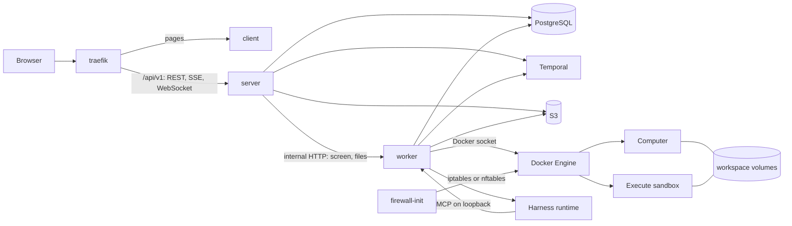

# Architecture

This document describes how Xavier is built: its processes, where data lives,
the Temporal workflows and the layout of the code. The subsystems have their own
documents:

- [Chats and the agent](agent.md) — chat states, turns, approvals, recovery.
- [Workspace, Execute and Compute](workspace.md) — the shared filesystem, code
  runs and the Computer.
- [Observe](observe.md) — deterministic monitoring of websites and APIs.
- [Web UI](web-ui.md) — the client application and its design conventions.

## Concepts

The unit of work is the **chat**. An operator writes to the agent in a chat; the
agent answers in **turns** and acts through **tools**. Every tool call is an
**action** that the policy allows, denies or holds for the operator's approval.

| Capability | What it does                                                       | Mechanism                                                                   |
| ---------- | ------------------------------------------------------------------ | --------------------------------------------------------------------------- |
| Observe    | Watch websites and APIs: history, changes, child resources, alerts | Deterministic scheduled polling without an LLM; the agent only drafts rules |
| Execute    | Computation, data processing, short scripts                        | A fresh isolated container per run, mounting the chat's `/workspace`        |
| Compute    | Browsing and interaction with an operating system                  | The chat's Computer: desktop, Chromium, terminal, `/workspace` and a home   |

Every chat has a **workspace**: the `/workspace` directory that Execute runs and
the Computer share. It survives idle periods and the loss of a host.

Interactive tasks are chats. Delayed and recurring tasks are **schedules** that
post a message into a new or a pinned chat. Parallel tasks are several chats.

## Components

The repository holds two applications:

- **`apps/server`** — the Python backend. One image (`apps/server/Dockerfile`)
  runs the `server` and `worker` services and the one-shot jobs through the
  `xavier` command line (`api`, `worker`, `migrate`, `init-storage`, `openapi`,
  `config-schema`, `bench`). The sandbox, desktop and firewall images are in
  `apps/server/images/`.
- **`apps/client`** — the TypeScript Web UI with its own image
  (`apps/client/Dockerfile`). It talks to the server only through the public
  REST API.

The services are defined in `docker-compose.yaml`; the infrastructure is a
separate project in `infra/docker-compose.yml` that creates the `xavier` network
the apps join.

- **`traefik`** is the single origin on port 8080. Labels on `server` and
  `client` hold the routes: `/api/v1` and everything under it go to `server`
  (port 8000), every other path outside `/api` goes to `client` (port 3000).
  Both `$XAVIER_DOMAIN` (default `localhost`) and `127.0.0.1` are accepted as
  hosts; any other host gets 404. One origin keeps the session cookie and the
  screen WebSocket same-site.
- **`client`** is TanStack Start on Nitro. The server renders only the document
  shell, with a per-request CSP nonce; pages load the operator's data in the
  browser.
- **`server`** (`apps/server/src/api`) serves REST v1, SSE, the screen WebSocket
  relay, the OpenAPI document and the health checks. It writes to PostgreSQL,
  sends commands to Temporal and reads S3. It has no Docker socket. The one-shot
  `server-migrate` and `server-init-storage` run the migrations and create the
  buckets before it starts.
- **`worker`** (`apps/server/src/orchestration/worker.py`) runs the Temporal
  workflows and activities and everything that needs Docker:
  - **Task queues.** The shared `xavier` queue carries workflows and
    host-independent activities; the worker's own `xavier.host.<worker_id>`
    queue carries activities for workspaces active on this host.
  - **Agent.** For every turn it starts the Harness runtime as a child process
    and serves it tools through an MCP gateway on 127.0.0.1.
  - **Internal server.** `apps/server/src/worker_http.py`, authorized by
    `worker.internal_token`, gives `server` the files and the screen of
    workspaces active on this host.
  - **Identity.** `worker.id` (the hostname by default) is stable across
    restarts. Every 10 s the worker records its id, internal address and a
    timestamp in the `workers` table; `server` finds a workspace's worker
    through it.
  - **Capacity.** At most `worker.max_workspaces` workspaces are active on a
    host. A new activation on a full host first hibernates the least recently
    used workspace without running work; if there is none, the call fails with
    `host_full`.
- **`firewall-init`** (`apps/server/images/firewall`) is a one-shot container
  with host networking and `NET_ADMIN` that installs the egress rules of the
  `xv-sandbox` bridge (see [security](security.md#egress)).
- **Infrastructure:** PostgreSQL; Temporal with the one-shot
  `temporal-setup-postgres` and `temporal-create-namespace` jobs and the
  Temporal UI; RustFS as S3. Their scripts are in `scripts/`.

## Data

Each piece of data lives in exactly one place.

| Store                 | Contents                                                                                                                                                                                  |
| --------------------- | ----------------------------------------------------------------------------------------------------------------------------------------------------------------------------------------- |
| PostgreSQL            | chats, messages, turns, actions and decisions, events, policy rules, workspaces, executions, artifact metadata, workers, leases, Observe sources, versions, alerts, encrypted credentials |
| Temporal              | execution lifecycle, timers, waits, schedules (the only source of truth for schedules)                                                                                                    |
| S3 `xavier-artifacts` | artifact contents, large tool results, Harness session snapshots, workspace checkpoints, Observe version bodies                                                                           |
| S3 `xavier-temporal`  | large Temporal payloads (External Storage)                                                                                                                                                |

The chat status in PostgreSQL is a read projection written only by the chat
workflow. A decision on an action is authoritative in PostgreSQL; workflows and
the gateway only wait for it. Identifiers are UUIDv7.

Keys in `xavier-artifacts`:

| Key                                                                                            | Content                           |
| ---------------------------------------------------------------------------------------------- | --------------------------------- |
| `artifacts/<artifact_id>`                                                                      | artifact content                  |
| `snapshots/<chat_id>/blobs/<sha256>`, `snapshots/<chat_id>/manifests/<turn_id>-<attempt>.json` | Harness session snapshots         |
| `workspaces/<chat_id>/checkpoints/<n>/workspace.tar.zst`, `.../home.tar.zst`                   | workspace checkpoints             |
| `observe/blobs/<sha256>`                                                                       | Observe values, content-addressed |

Payloads larger than `temporal.payload_size_threshold` (256 KiB) go to
`xavier-temporal` through the Temporal data converter
(`apps/server/src/orchestration/converter.py`), so workflow histories hold
references, not large data.

### Retention

`MaintenanceWorkflow` deletes data after the periods in `retention.*`:

| Data                                                       | Kept                                                                       |
| ---------------------------------------------------------- | -------------------------------------------------------------------------- |
| Session snapshots                                          | the last three manifests per chat; deleted when the chat is deleted        |
| Workspace checkpoints                                      | the last two; a hibernated workspace for `retention.checkpoints` (30 days) |
| A deleted chat with its messages, turns, events, artifacts | `retention.deleted` (30 days), then purged entirely                        |
| Executions started through the API, with their artifacts   | `retention.executions` (30 days)                                           |
| Observe versions                                           | while the source exists; unreferenced values are deleted with it           |
| Large Temporal payloads                                    | the bucket lifecycle rule `s3.temporal_payload_ttl_days` (90 days)         |
| Workflow histories                                         | Temporal namespace retention (7 days after completion)                     |

## Workflows

| Workflow               | Role                                                                                                                                                     |
| ---------------------- | -------------------------------------------------------------------------------------------------------------------------------------------------------- |
| `ChatWorkflow`         | one per chat (workflow id = chat id): status, one turn at a time, the input queue, approval waits and timers, pause, stop, delete, workspace hibernation |
| `ChatScheduleWorkflow` | started by a Temporal Schedule; creates or finds the chat and posts the message                                                                          |
| `ExecutionWorkflow`    | one code run, from a chat's `code_run` or from `POST /executions`                                                                                        |
| `ObservePollWorkflow`  | one poll of an Observe source, started by its Temporal Schedule                                                                                          |
| `MaintenanceWorkflow`  | every 10 min: orphaned containers and volumes, chats with stuck queued input, retention, stale Observe sources                                           |

Workflow conventions:

- Activities on a host queue have a 60 s `schedule_to_start` timeout, so the
  loss of a host is detected instead of waiting forever.
- Long activities heartbeat; fencing and policy errors are non-retryable.
- PostgreSQL transactions are never held across waits.
- Incompatible changes to `ChatWorkflow` go behind `workflow.patched`; a replay
  test runs stored histories against the current code (see
  [testing](testing.md#workflow-replay)).
- Temporal calls are traced through the OpenTelemetry interceptor.

## API

REST v1 lives under `/api/v1` and is described by OpenAPI at
`/api/v1/openapi.json`, with Swagger UI at `/api/v1/docs`. The health checks are
`/api/v1/healthz` (the process serves) and `/api/v1/readyz` (PostgreSQL and
Temporal answer).

- **Authorization.** A user signs in with `POST /api/v1/auth/session`
  (`{data: {username, password}}`), which returns 201 and sets the HttpOnly
  cookie `xavier_session` (`SameSite=Strict`, `Secure` over HTTPS). The Web UI
  uses the cookie, which also authorizes SSE and the screen WebSocket. Programs
  send `Authorization: Bearer xv_…`, an API key whose full value is returned
  once, at creation, and stored only as a hash. Listing and revoking sessions
  (`/sessions`) and API keys (`/api-keys`) require that cookie; an API key gets
  403. Every resource is scoped to its owner (`created_by`); another user's
  resource is 404. A user-editable record also returns `updated_by`, the last
  user who changed it, or null when none has. Spending, polling and credential
  use do not change that field. Sessions last `auth.session_ttl` (P30D) and end
  after `auth.session_idle_ttl` (P7D) without use.
- **Errors** are `{message, success: false}`. A 422 validation error adds
  `details: [{loc, msg, type}]`. OpenAPI lists the errors the handler and its
  dependencies raise.
- **Pagination.** One object is `{data, success: true}`. A list is
  `{data, info, success: true}`, where `info` is
  `{cursor, page, per_page, has_next, total_pages, total_items}`. Query
  parameters are `page`, `per_page` (default 50, at most 200), `cursor` (an item
  id that anchors the page), `sort`, `direction` (`asc` or `desc`) and
  `filter[<field>]` (one or more).
- **Long operations** are created with 201 and the new record. A delete returns
  200 with the deleted item.
- **Live updates.** A chat's events stream over SSE with resumption from the
  last delivered event.
- **Outages.** When PostgreSQL, S3 or Temporal is unreachable, requests answer
  `503` and succeed again once it is back.
- **No internals.** Temporal ids and Harness or Docker details never leave the
  API.

## Telemetry

- Logs are JSON in containers and plain text on a console (`logging.format`);
  one configuration covers `server`, `worker` and uvicorn, and a filter redacts
  secrets.
- Traces and metrics are exported over OTLP when `telemetry.otlp_endpoint` is
  set: FastAPI instrumentation, the Temporal interceptor and spans for turns,
  tool calls, executions, workspace activation and checkpoints, and fetches.
- Metrics cover turn duration, outcomes and retries, tool calls by status,
  tokens and cost, workspace activation, Computer start and run times,
  checkpoint size and time, and Observe errors.
- `GET /api/v1/metrics/summary` serves usage, cost and run figures to the Web
  UI.

## Code layout

`apps/server/src/` is the `src` package:

| Module                                              | Role                                                                                                        |
| --------------------------------------------------- | ----------------------------------------------------------------------------------------------------------- |
| `__main__.py`                                       | the `xavier` command line                                                                                   |
| `config.py`, `errors.py`, `logs.py`, `telemetry.py` | settings, domain errors with their HTTP status, logging, OpenTelemetry                                      |
| `db/`                                               | SQLAlchemy models, engine, Alembic migrations                                                               |
| `storage/`                                          | S3 blobs and artifacts                                                                                      |
| `events.py`, `leases.py`                            | the chat event log with `LISTEN`/`NOTIFY`; leases with fencing tokens                                       |
| `policy/`                                           | risk and modes, the rule engine, URL and path checks, secret redaction                                      |
| `tools/`                                            | tool contracts and handlers: observe, execute, compute, jobs, capabilities, credentials, wakeups, MCP proxy |
| `agent/`                                            | MCP gateway, turn runner, Harness profile, questions, embeds, proactive, capabilities, history rewind       |
| `auth/`, `credentials/`                             | users, sessions and API keys; credential grants, hosts and audit                                            |
| `orchestration/`                                    | workflows, activities, schedules, the data converter, the worker                                            |
| `workspace/`, `execute/`, `compute/`, `docker/`     | volumes and checkpoints, code runs, the Computer and its pool, the Docker client                            |
| `observe/`                                          | source specs, fetching, extraction, normalization, structure, credentials, polling                          |
| `api/`, `worker_http.py`                            | the REST API; the worker's internal server                                                                  |
| `bench.py`                                          | the `xavier bench` measurements                                                                             |

`apps/client/src/` is described in [Web UI](web-ui.md#code-layout).

Replaceable backends are protocols: `ComputerBackend` and `SandboxBackend`
(Docker), `BlobStore` (S3) and the Observe fetchers (HTTP and browser).
Everything else is a plain service.
