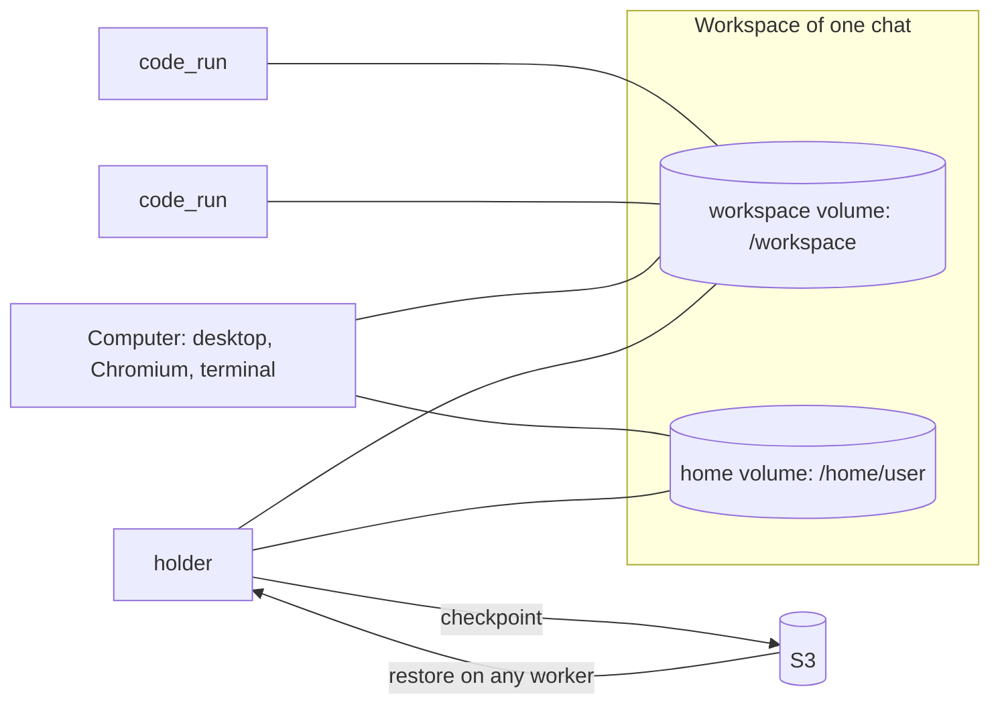
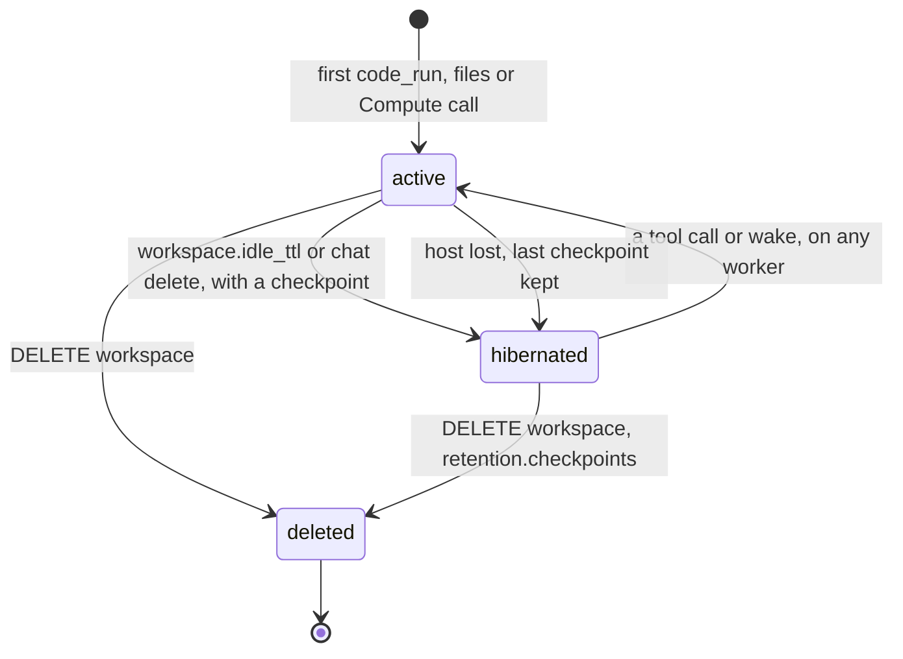

# Workspace, Execute and Compute

Every chat gives AI one **workspace** shared by code runs and the Computer at
`/workspace`. A script can download data that the browser then opens, and a file
downloaded in the browser can be processed by the next script. This lets one
task move naturally between browsing, code and files.



## Workspace

### Composition

- **The `workspace` volume** is `/workspace` in the Computer and in every code
  run of the chat.
- **The `home` volume** is `/home/user` in the Computer only: the Chromium
  profile, desktop settings, `pip --user` packages. Code runs do not see it.
- **The holder** is a container of the sandbox image with no network that mounts
  both volumes and runs `sleep infinity`. Service operations run in it with
  fixed commands: packing and unpacking checkpoints, `files` operations, size
  measurement.
- Every container runs as uid 1000. Containers and volumes carry the labels
  `xavier.chat=<id>` and `xavier.worker=<id>`, so a worker can find and remove
  what it owns.

Files the operator attaches to a message are written to `/workspace/inbox/`. The
agent delivers results with `files export` or the `export` list of `code_run`;
both turn files into downloadable artifacts. The **Files** tab of a chat lists
and downloads the files of an active workspace.

### Lifecycle



The `workspaces` row holds the status, the host, the volume and container names,
the last checkpoint, its time and size, and an `epoch` that grows with every
activation. Transitions are compare-and-set on the status and the epoch, so two
workers can never both own a workspace.

**Activation.** The call that needs the workspace activates it on the worker
that runs it: `code_run`, `files`, a Compute tool, a message attachment, or
`wake` from the API or the Web UI.

1. Claim the row (`hibernated` or new → `active`) with this worker as host and a
   new epoch. On a full host, first hibernate the least recently used workspace
   that has no running executions, terminal jobs or operator control; if none
   qualifies, fail with `host_full`.
2. Take a Computer from the warm pool when the call needs one and use its
   volumes; otherwise create new volumes.
3. Start the holder and stream the checkpoint archives from S3 into it.
4. The next turn gets a `workspace_restored` notice with the checkpoint time.

If a Computer is needed later, it starts on the existing volumes.

**Checkpoint.** After a turn that changed something, and before hibernation:

1. Check for changes since the last checkpoint with `find -newer` in the holder.
2. Pack each volume with `tar --zstd`, without caches, and stream it to S3 as a
   multipart upload.
3. Store the checkpoint pointer only if the epoch still matches; keep the last
   two checkpoints.

**Hibernation** happens after `workspace.idle_ttl` (15 min) without a tool call
that touches the workspace, and never while executions, terminal jobs or
operator control are active. It stops the Computer, takes a final checkpoint and
removes the containers and volumes. Deleting the chat hibernates the workspace
the same way. **Deletion** — `DELETE /chats/{id}/workspace`, or after
`retention.checkpoints` for a hibernated workspace — removes the volumes and
every checkpoint. A deleted chat, including those checkpoints, is purged after
`retention.deleted`.

**Size.** `workspace.size_limit` (2 GiB) applies to both volumes together. The
holder measures them with `du` before every code run, every `files import` and
every checkpoint. Over the limit, those writes fail with `workspace_full` and no
checkpoint is taken.

### What persists

Files persist: across turns, idle periods, worker restarts and moves between
hosts. Running processes, terminal jobs and unsaved application state do not.
Chromium tabs come back from its profile in the home volume.

Code runs and the Computer may write to `/workspace` at the same time, like
processes on one machine. The platform does not lock files; the system prompt
asks the agent to coordinate its own writes.

## Execute

### Sandbox image

`xavier-sandbox` (`apps/server/images/sandbox`) is Python 3.14 on Debian trixie,
pinned by digest, with `numpy`, `pandas`, `requests`, `httpx`, `lxml` and
`matplotlib` pinned with hashes, Node.js, bash, `tar` and `zstd`. Adding a
language means extending the image and the `language` values in
`apps/server/src/execute/service.py`.

### Run container

Each run is a new container, removed after the run:

- uid 1000, read-only root filesystem, `/tmp` in tmpfs (`execute.tmp_size`);
- `/workspace` is the chat's workspace volume; runs started through the API get
  a tmpfs instead;
- all capabilities dropped, `no-new-privileges`, CPU, memory (without swap) and
  PID limits from `execute.*`;
- no network by default; with `network: true` in a chat that allows
  `execute_network`, the `xv-sandbox` bridge, which reaches only the public
  internet;
- the OCI runtime `execute.runtime`: `runc` by default, `runsc` where gVisor is
  installed.

### `ExecutionWorkflow`

Every run is a workflow with one activity, `run_execution`:

1. create the container;
2. for an API run, copy the input artifacts into `/workspace`;
3. run the program under `timeout -s KILL` with `execute.max_duration`;
4. collect stdout and stderr up to `execute.output_limit`, the exit code and
   cgroup metrics;
5. upload the `export` paths as artifacts;
6. remove the container.

A run from a chat goes to the host queue of the chat's workspace, which the
gateway activates first; an API run goes to the shared queue. `code_run` waits
up to `wait_s` for the result and otherwise returns a `job_id` (the execution
id) for the `job` tool; the API answers `201` with the execution record at once.

A run is retried automatically only while its code has not started. Once it
started, losing its worker makes it `uncertain`. Statuses: `pending`, `running`,
`succeeded`, `failed`, `cancelled`, `timeout`, `uncertain`.

Runs without a chat:

```bash
curl -sS -X POST http://localhost:8080/api/v1/executions \
  -H "Authorization: Bearer $XAVIER_API_KEY" -H 'Content-Type: application/json' -d '{
  "data": {
    "language": "python",
    "code": "import math; print(math.factorial(30))"
  }
}'
curl -sS http://localhost:8080/api/v1/executions/<execution_id> \
  -H "Authorization: Bearer $XAVIER_API_KEY"
```

The Web UI lists them under **Code runs**.

## Compute

### Desktop image

`xavier-desktop` (`apps/server/images/desktop`) is Debian trixie with Xvfb,
openbox with a wallpaper and a `tint2` dock (Chromium, terminal, files),
Chromium, x11vnc, libxdo, `socat`, Python 3.14 and Node.js. The desktop's
defaults live in the image, not in the home volume, so every Computer starts
with them.

The Computer container has a read-only root filesystem with `/tmp` in tmpfs, the
workspace volumes, the `xv-sandbox` network, no capabilities,
`no-new-privileges`, and CPU, memory and PID limits from `computer.*`. Chromium
keeps its own sandbox, which needs a seccomp profile with `clone`, `unshare` and
`chroot` added (see [security](security.md#isolation-of-code-and-the-computer)).
Its enterprise policy (`chromium-policy.json`) blocks loopback, cloud metadata
and `file://` pages outside `/workspace`, and sends downloads to
`/workspace/downloads`.

### `computerd`

`computerd` (`apps/server/images/desktop/computerd.py`) is a long-lived process
inside the Computer, started by one `docker exec`:

- it speaks JSON lines over stdin and stdout; requests carry an id, and
  responses arrive when each command finishes;
- it drives Chromium over `--remote-debugging-pipe`, so no debugging port is
  exposed, and restarts it if it crashes;
- it takes screenshots in-process and sends mouse and keyboard input through
  libxdo;
- it keeps terminal jobs with a ring buffer of their output;
- it rejects `browser` and `screen` commands whose GUI lease token is older than
  one it has seen.

The worker keeps one channel to `computerd` per Computer
(`apps/server/src/compute/channel.py`), so an action costs neither a new process
nor a network connection. The dock's Chromium launcher asks `computerd` for a
window over `/tmp/computerd.sock`, so only `computerd` runs Chromium on the
profile.

### Two ways to act

**`browser` (semantic).** One `snapshot.js` call returns a table of the visible
interactive elements with stable ids such as `e12` — role, name, value, state —
plus visible text up to a limit. Password values are never returned. Actions
refer to elements by id; before input, the element's freshness and occlusion are
checked, and input uses trusted CDP events. A batch of actions returns one new
snapshot, so a multi-step task needs few model calls.

**`screen` (visual).** A JPEG of the 1280×800 screen, optionally with the
browser's elements outlined and labelled by id, and mouse and keyboard input
through libxdo. Screenshots go only to models with image input. `screen` covers
what the snapshot does not: canvas, iframes, shadow DOM and other applications.

### GUI lease

`browser` and `screen` calls need the chat's GUI lease, a row in PostgreSQL with
a fencing token. Parallel calls of one turn queue for it; a call waits up to 30
s for another holder to finish and then fails with `env_busy`, as it does at
once while the operator holds control. `terminal` and `files` do not need it.

### Screen and operator control

The screen reaches the browser through `server` ↔ the worker's internal server ↔
`docker exec socat` ↔ x11vnc, which listens on two loopback ports inside the
container: view-only and control. `server` finds the worker through
`workspaces.host` and the `workers` table.

- **Viewing** is always allowed. Opening the screen of a hibernated workspace
  wakes it, and the Web UI reconnects once it is active.
- **Control.** **Take control** in the **Computer** tab
  (`POST /chats/{id}/computer/control`) takes the GUI lease for
  `computer.control_ttl`. It is renewed while the control stream is open and
  released when it closes or with **Give back to the agent**. Meanwhile the
  agent's `browser` and `screen` calls fail with `env_busy`, and the workspace
  does not hibernate.

### Warm pool

Each worker keeps `computer.pool_size` ready Computers, each with its own empty
volumes and Chromium running on an empty profile. A new workspace that needs a
Computer takes one and adopts its volumes, which skips the cold start; the pool
refills in the background. When a workspace is restored into a pool Computer,
Chromium restarts after the home volume is unpacked.

## Limitations

- Containers share the host kernel. gVisor (`execute.runtime: runsc`)
  strengthens code-run isolation on Linux only.
- A code run with network access can send the contents of `/workspace` to the
  internet.
- Size is checked before writes, not enforced by a quota: a single run can
  exceed the limit. Put Docker volumes on a dedicated partition in production.
- After the loss of a host, changes since the last checkpoint are lost.
- Only the volumes persist. Anything written elsewhere, such as `/tmp`, is lost
  with the container.
- The page snapshot does not cover iframes, shadow DOM or canvas; `screen`
  covers them.
